<picture>
  <source media="(prefers-color-scheme: dark)" srcset="./assets/header-dark.svg">
  <source media="(prefers-color-scheme: light)" srcset="./assets/header-light.svg">
  
</picture>

# Hi, I'm Mohammadamin.

**Frontend engineer working with React and Next.js, with hands-on UI/UX design experience.** Based in Shiraz, Iran.

I turn requirements and Figma designs into reusable interfaces. My work spans national warehouse and trade platforms, Odoo-based ERP modules, and independent web products. I care about how an interface feels, how its state behaves, and how easy its code is to change.

  
  
  

<!-- Add the portfolio link here once the final public URL is confirmed. -->

## What I bring to a project

- **Interface engineering:** reusable components, application state, API integration, and careful design implementation.
- **Design awareness:** UI/UX work, stakeholder feedback, and Persian RTL interfaces with localized numbers and dates.
- **Maintenance:** investigating frontend errors, improving existing code, and working within connected systems.
- **Product thinking:** questioning requirements, prototyping ideas, and keeping the implementation aligned with the user flow.

## Code you can explore

These are public architecture samples, coding challenges, and an earlier technical assessment—not a complete list of my professional work.

| Project | A good place to look |
| --- | --- |
| [**Next.js Blueprint**](https://github.com/ihosseininejad/nextjs-blueprint) | A Persian RTL learning-platform frontend: App Router structure, typed UI components, Storybook stories, Jest tests, TanStack Query, and Zustand. **Work in progress; requires a separate backend.** |
| [**Liara Resolve**](https://github.com/ihosseininejad/liara-vibe-codding-challenge) | An AI-assisted challenge project: a documentation-grounded support workflow with retrieval, evidence checks, fallback responses, and a Persian interface. **Next.js · TypeScript · Vitest** |
| [**ZarinPal Decision Intelligence**](https://github.com/ihosseininejad/zarinpal-vibe-coding-challenge) | An AI-assisted analytics challenge: merchant dashboards, bilingual formatting, deterministic metrics, and evidence-backed explanations. **Next.js · FastAPI · DuckDB** |
| [**Arvan Reseller Hub**](https://github.com/ihosseininejad/ac-pluggin-vibe-codding-challenge) | An AI-assisted WordPress plugin challenge: React onboarding, customer portals, cloud-server workflows, and a wallet with mock top-ups. **React · TypeScript · PHP** |
| [**React Map Assessment**](https://github.com/ihosseininejad/reactjs-exam) | An earlier React assessment with authenticated routes, Context + reducer state, reusable form controls, and Leaflet location picking. **React · TypeScript · Sass** |

## Beyond the public repos

At **Mehr Pars** and **Web365**, I contributed to national platforms, ERP interfaces, education products, and client websites. The work included shared panel components, UI redesigns, frontend monitoring with Countly, and collaboration with frontend, backend, and design teams.

Some of that work is private. I describe my role and contributions without publishing confidential source code or client details.

## Tools I work with

**Frontend**

<picture>
  <source media="(prefers-color-scheme: dark)" srcset="https://skillicons.dev/icons?i=react,nextjs,ts,js,tailwind,html,css&amp;theme=dark">
  
</picture>

**Design, quality & workflow**

<picture>
  <source media="(prefers-color-scheme: dark)" srcset="https://skillicons.dev/icons?i=figma,git,jest,vitest&amp;theme=dark">
  
</picture>

- **State & data:** TanStack Query, Zustand, React Context
- **Component workflow:** Storybook, React Testing Library
- **Professional context:** AngularJS maintenance, Odoo / OWL, Countly
- **Currently exploring:** AI-assisted development, retrieval workflows, and evidence-grounded assistants

---

**Thoughtful design. Maintainable code. Useful interfaces.**
